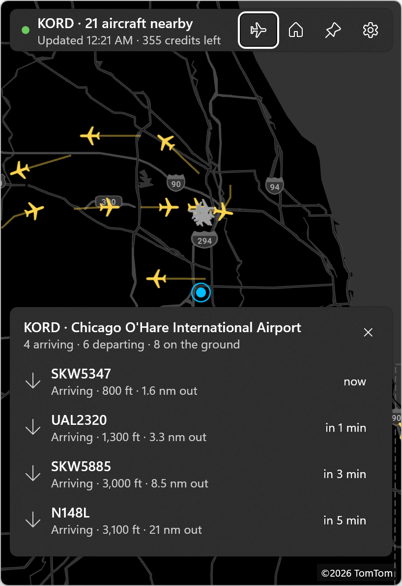

# Tiny ATC



Live air traffic around you, from the Windows notification area: click the tray icon for a map of the aircraft overhead, or let the tray icon itself scroll the flights above you.

Tiny ATC is a WinUI 3 tray app. It has no main window: the tray icon opens a small, always-on-top flyout next to the icon, with a live map built from [The OpenSky Network](https://opensky-network.org)'s ADS-B data.

## Features

- **Live map:** every aircraft in view, drawn as a plane pointing along its track: amber in the air, gray on the ground. Positions are dead-reckoned between polls, so traffic glides instead of jumping. Each aircraft trails a short line of where it has been since the map opened.
- **Flight paths:** tap an aircraft to see its callsign, ICAO address, registration country, altitude, ground speed, vertical rate, track, squawk and distance, plus its full path so far from OpenSky's track data. When the path starts on the ground at a known airport, the card shows where it took off from.
- **Favorite airports:** add airports in Settings (search by ICAO or IATA code, name or city; about 5,000 large and medium airports are bundled). Pick one from the airplane button, or tap its ring on the map, to see live traffic in and out: arrivals with ETAs, departures with climb rates, and ground traffic.
- **Starts where you are:** the map opens at your device location, or at the view you saved with the pin button. The home button returns to it. Zoomed far out, the map fetches the area around its center (one OpenSky credit's worth) and outlines it with a dashed box.
- **Tray marquee** (opt-in): the tray icon becomes a tiny ticker that scrolls the flights overhead, for example `UAL123 35k ft 4 nm NE`. Each frame is rendered and swapped into the notification icon as the text moves. The tooltip lists the same flights. Turn it on from the tray menu ("Scroll flights overhead") or Settings, and choose the radius (5–40 km), scroll speed and units.
- **Favorite flights:** tap the star on a selected aircraft to watch it. Its status (callsign, altitude, speed) goes in the tray tooltip and tray menu, and a toast tells you when it lands. Up to 20 flights; one is dropped once it lands or goes unseen for a day.

  

- **Units:** aviation (ft, kt, nm), imperial (ft, mph, mi) or metric.
- **Light dismiss:** the flyout hides when it loses focus. Escape closes the aircraft or airport card first, then the flyout. Clicking the tray icon toggles it.
- **Tray menu:** right-click for Open Tiny ATC, Scroll flights overhead, Settings, and Exit.
- **Theme-aware:** the flyout, the basemap (Azure Maps grayscale dark or light) and the tray icon and marquee text follow the Windows taskbar theme and switch live.
- **Single instance:** launching the app again opens the running instance's flyout.
- **Offline and rate limits:** when OpenSky can't be reached, the flyout says why, keeps the last traffic on the map, and backs off. When OpenSky's daily limit is hit, it says when traffic resumes.

## OpenSky credits

OpenSky meters its API in credits: **400 a day anonymously, 4,000 a day with a free account.** Tiny ATC keeps every request at 1 credit (no larger than 25 square degrees) and paces itself:

| | Anonymous | With an API client |
|---|---|---|
| Map refresh while the flyout is open | every 20 s | every 10 s |
| Tray marquee refresh | every 10 min | every minute |
| Favorite flights refresh (one request for all) | every 10 min | every 2 min |

The marquee reuses the map's data whenever the map is open and covers your area. Selecting an aircraft fetches its track once (cached for 2 minutes). The header shows the credits OpenSky reports as left.

To use an account, create an API client on your [OpenSky account page](https://opensky-network.org/my-opensky/account) and paste its client ID and secret into Settings > OpenSky account. Tiny ATC verifies them before saving.

## Install

There's no release yet. Build from source (below), or package an MSIX with `build-msix-for-gh.ps1`. Sideloading a self-signed MSIX requires trusting its signing certificate first.

Requirements: Windows 10 1809 (build 17763) or later, x64 or ARM64.

## Setup

- **Location:** allow location for Tiny ATC in Settings > Privacy & security > Location, or switch Settings > Location to "Use my saved map view" and save a view with the pin button.
- **Basemap key (build from source):** copy `OAuth.resw.sample` to `OAuth.resw` (gitignored) and paste an [Azure Maps](https://learn.microsoft.com/azure/azure-maps/) key into `AzureMapsKey`. Without a key, the map uses OpenStreetMap's standard tiles.
- **OpenSky account (optional):** see above.

## Privacy and footprint

- **Network:** the app calls OpenSky (`opensky-network.org`, and `auth.opensky-network.org` when signed in) and the map tile service only while the flyout is open. The exceptions are the tray marquee (when you turn it on, it asks OpenSky for the area around your home on the schedule above) and favorite flights (while you have any starred, it asks OpenSky about them on the schedule above). Nothing else runs in the background.
- **Location:** your device location is used to center the map and measure "overhead". It is stored in the app's local settings and sent nowhere except as the bounding box of an OpenSky request.
- **Secrets:** the OpenSky client secret is stored in Windows Credential Manager (PasswordVault), never in settings files or logs.
- **Memory:** after the flyout has been hidden for a minute it closes for real and the app releases its memory. Measured idle with the marquee scrolling: about 22 MB working set.

## Build from source

Prerequisites: the [.NET 10 SDK](https://dotnet.microsoft.com/download), the [winapp CLI](https://github.com/microsoft/WinAppCli) (`winget install Microsoft.WinAppCli`), and Developer Mode.

```powershell
winapp run              # build, register with package identity, launch
winapp run --clean      # same, from a clean first-run state
winapp run -c Release   # trimmed ReadyToRun build
dotnet test TinyAtc.Tests
```

The first run opens the flyout. After that the app lives in the tray; look in the overflow (^) if the icon is hidden.

`build-msix-for-gh.ps1` builds signed x64 and ARM64 MSIX packages and drafts a GitHub release. The airport list is regenerated from [OurAirports](https://ourairports.com/data/) with `dotnet run --file scripts/BuildAirports.cs`.

## Project layout

| Path | What it holds |
|---|---|
| `App.xaml.cs` | Tray icon, context menu, single instance, the tray marquee, crash logging |
| `Views/TrayFlyoutWindow` | Borderless popup: placement, light dismiss, animation, idle close |
| `Views/FlyoutPage` | The map: polling, plane icons, trails, selection and flight paths, airport mode |
| `Views/MapVisuals.cs` | Shared plane, airport and home icons and the map's colors |
| `Views/SettingsWindow` | Location, tray marquee, units, favorite airports, OpenSky account, startup |
| `Services/TrayMarquee.cs`, `MarqueeFont.cs` | Background overhead polling, GDI text strip, per-frame tray icons |
| `Services/OpenSkyService.cs`, `OpenSkyAccount.cs` | The shared OpenSky client, latest snapshot, credentials in PasswordVault |
| `TinyAtc.Core` | UI-free logic: OpenSky client and parser, geo math, airport catalog and traffic classification, marquee frames and ICO encoding, polling policy |
| `TinyAtc.Tests` | MSTest coverage for `TinyAtc.Core` |

## Data and credits

- Flight data: [The OpenSky Network](https://opensky-network.org), used under its terms for non-commercial use.
- Airports: [OurAirports](https://ourairports.com) (public domain).
- Map: Azure Maps (© TomTom) or © OpenStreetMap contributors, rendered with [WinUIEx.Maps](https://github.com/dotMorten/WinUIEx.Maps) (free for non-commercial use; commercial use requires sponsoring the author).

## License

MIT, see [LICENSE](LICENSE).
